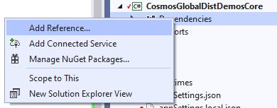
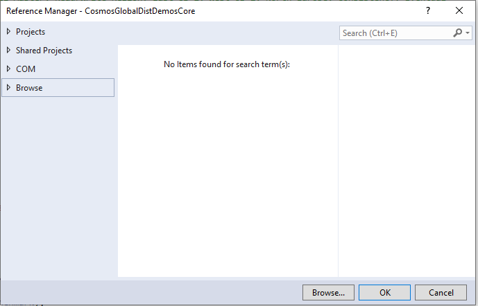
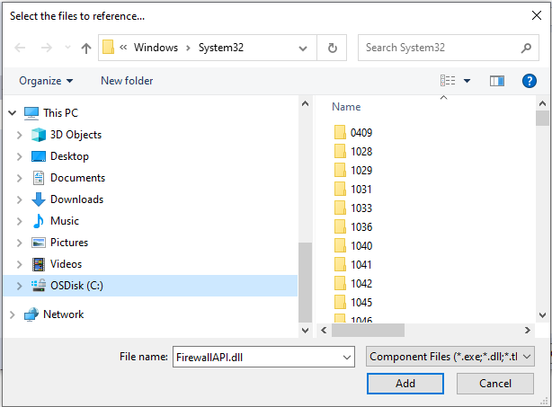
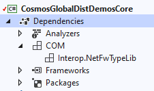

# Cosmos Global Distribution Demos

## Introduction

This solution contains a series of benchmarks that demonstrate various concepts for distributed databases, particularly around 
consistency and latency. The tests in this solution include:

### 1. Read latency between single region and multi-region replicated accounts

This test shows the difference in read latency for an account with a single master in East US 2 with a front end
reading from it in West US 2. The next test shows the drastic improvement in latency with data locality when the account is 
replicated to West US 2.

### 2. Write latency for accounts with Eventual consistency vs. Strong consistency + impact of distance on Strong consistency

This test shows the difference in write latency for two accounts with replicas 1000 miles apart in West US 2 and Central US regions,
one with Eventual consistency, the other with Strong consistency. There is a third test that shows the impact on latency when the 
distance between the regions is more than double the distance, demonstrating the speed of light impact on latency when using Strong 
consistency across large distances.

### 3. Read and write latency for Single-Master account versus Multi-Master account

This test shows the difference in read latency for a single-master account (master: East US 2, replica: West US 2) with a client in 
West US 2. The next test shows the impact on write latency when using a multi-master account (master: East US 2, West US 2) with 
a client in West US 2.

### 4. Multi-Master Conflict Resolution

This test generates conflicts and demonstrates conflict resolution for Last Write Wins, Custom Merge Procedure, and "Async" conflict 
resolution modes where conflicts are written to the conflicts feed and then read and resolved.

### 5. Multi-Master Failover

This test conducts a failover in the SDK client in Multi-Master mode by adding a firewall rule in Windows to block the ip address for 
the region being read from. Note: This requires the application runs on Windows 10 and Visual Studio be run as Administrator.

## Provisioning Cosmos DB accounts

This solution requires seven different Cosmos DB accounts. Each of are configured differently to support the underlying test with 
different replication modes, consistency levels and regions.

To deploy the Cosmos DB accounts for this solution, follow the steps below.

### Steps

1. Click **Deploy to Azure**, or deploy `infra/main.bicep` using Azure CLI. Use a **dedicated resource group** and a globally unique `environmentName` prefix. The deployment creates seven accounts, their databases, containers, stored procedures and a user-assigned managed identity. Key authentication is disabled.
2. Choose the identity that will run the demos. On an Azure VM, attach the deployed identity (output `managedIdentityResourceId`) to the VM and set `AZURE_CLIENT_ID` to the `managedIdentityClientId` output before starting Visual Studio. For local development, set the optional deployment parameter `developerPrincipalId` to your user's **object ID** (`az ad signed-in-user show --query id -o tsv`) and sign in as that user with Azure CLI or Visual Studio. The template grants Cosmos DB Built-in Data Contributor on each account; allow time for the assignments to propagate.
3. In the deployment **Outputs**, find `endpoints`. Create `source/appSettings.local.json` as a JSON object using each `setting` as the property name and its full `endpoint` URI as the value. The demos use `DefaultAzureCredential`; no account keys are required.

## Provision Windows VM as Host

These tests are designed to run from a Windows VM in West US 2. Due to the Multi-Master Failover Test, this will need to be a Windows 10 VM.
The VM should be configured with a minimum 4 vCPU's and 16 GB of memory with RDP enabled. After the VM has been provisioned, RDP into it 
and install Visual Studio with .NET 9 support, then copy or clone the solution to the VM and configure `source/appSettings.local.json` there.

To run the demo, RDP into the VM, open the solution folder, launch the solution and press F5.

[!Note]
> You can run this demo from your local machine however the latency benchmarks will be dramatically slower and will not show actual, 
SLA-based Cosmos DB latency metrics.

[!Note]
> To change regions, edit `infra/main.bicep` and the corresponding settings in `source/AppSettings.json`. Regenerate the portal template with `bicep build infra/main.bicep --outfile infra/azuredeploy.json`.

## Configure the project to run the Multi-Master Failover Test

This test requires additional configuration in Visual Studio because it modifies the firewall settings on the Windows VM. Follow the 
steps below to configure this test.

### Add Dependancies

Right click Dependancies and select Add Reference.

### Click Browse

Next click Browse on left hand side and then Browse button on the bottom of the dialog.

### Select FirewallAPI.dll

Type in FirewallAPI.dll into the File Name box, then click Add.

### Confirm Interop.NetFwTypeLib

Finally verify that the Interop.NetFwTypeLib appears in COM folder

## Initializing the Demos

After deployment, use **Initialize** to check access and seed empty read-benchmark partitions. Read and failover demos also seed on demand using the deployed `BulkImport` procedure. Existing data is reused.

[!IMPORTANT]
> The ten containers have 400 RU/s each, billed in each replicated region. Exiting the app does not stop charges. When finished, delete the dedicated demo resource group in Azure after checking its contents. The app's data-plane identity cannot delete infrastructure.
